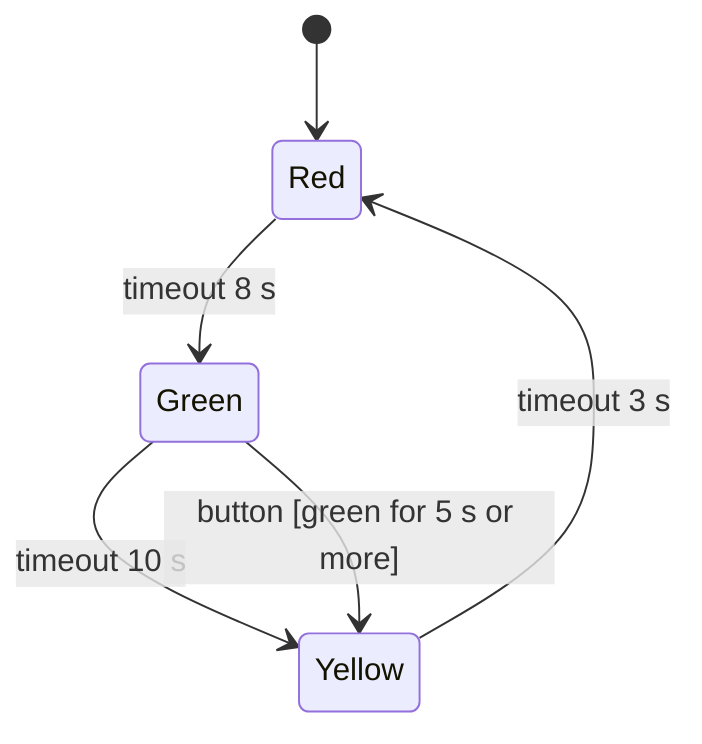

# embedded-cpp-toolkit

[](https://github.com/PATEmbedded/embedded-cpp-toolkit/actions/workflows/ci.yml)
[](LICENSE)

Header-only C++17 building blocks for firmware: a non-blocking state machine, values that notify on change, weekly time-window schedules, validation of JSON requests, a debouncer and a periodic timer. They come from building-automation controllers and have no hardware dependency, so they run on any MCU with a C++17 compiler and are unit tested on a PC.

| Header | What it does |
|---|---|
| `ect/state_machine.hpp` | Table-driven finite state machine with entry and exit handlers, guards, actions and per-state timeouts |
| `ect/observable.hpp` | A value that calls subscribers with the old and new value when it changes; optional mutex for multi-task use |
| `ect/weekly_schedule.hpp` | Maps every moment of the week to a value: "relay on 07:30-18:00 on weekdays", windows past midnight, fixed storage |
| `ect/json_schema.hpp` | Declarative validation of ArduinoJson 7 documents with the path of the first error, for REST bodies and configuration files |
| `ect/debouncer.hpp` | Time-based debouncing of buttons and switches, with rising and falling edges |
| `ect/periodic.hpp` | "Every N ms" without blocking, safe when the millisecond counter wraps |

All timing takes the current time as an argument (`millis()`, a FreeRTOS tick count or a fake clock in tests), and all unsigned time arithmetic is correct across counter wrap-around.

## State machine

The states and transitions are two constant tables, so they can live in flash and be read like a diagram. Nothing blocks: `dispatch()` handles an event and `update()` turns an expired state timeout into an event.



```cpp
using machine = ect::state_machine<light, event, crossing>;

constexpr machine::state_type states[] = {
    {light::red, 8000, enter_red, nullptr},
    {light::green, 10000, enter_green, nullptr},
    {light::yellow, 3000, enter_yellow, nullptr},
};

constexpr machine::transition_type transitions[] = {
    {light::red, event::timeout, light::green, nullptr, nullptr},
    {light::green, event::timeout, light::yellow, nullptr, nullptr},
    {light::green, event::button, light::yellow, green_long_enough, nullptr},
    {light::yellow, event::timeout, light::red, nullptr, nullptr},
};

machine traffic_light(states, transitions, context, event::timeout);

void loop() {
    const uint32_t now = millis();
    if (button.update(digitalRead(BUTTON_PIN) == HIGH, now) && button.fell()) {
        traffic_light.dispatch(event::button, now);
    }
    traffic_light.update(now);
}
```

The full program is in [examples/traffic_light](examples/traffic_light/src/main.cpp).

## JSON validation

```cpp
using ect::json::field;
using ect::json::schema;

const schema relay = schema()
    .add("pin", field::integer().required().range(0, 39))
    .add("days", field::string().required().one_of({"weekdays", "weekend", "every_day"}))
    .add("on", field::string().required().check(is_time, "must be HH:MM"))
    .strict();  // unknown keys are an error

const schema request = schema()
    .add("relays", field::array().required().length(1, 4).each(field::object(relay)))
    .strict();

const ect::json::result check = request.validate(doc.as<JsonVariantConst>());
if (!check) {
    // for example: relays[1].days is not an allowed value
    send_error(400, check.path + " " + check.reason);
}
```

Built-in checks: `ect::json::ipv4` and `ect::json::hostname`.

## Weekly schedule

```cpp
ect::weekly_schedule<bool> lights(false);
lights.set(ect::weekdays, *ect::time_of_day::parse("18:00"), *ect::time_of_day::parse("23:00"), true);
lights.set(ect::days(ect::weekday::saturday), *ect::time_of_day::parse("22:00"), *ect::time_of_day::parse("02:00"), true);

bool on = lights.value_at(ect::weekday_from_tm(now.tm_wday), ect::time_of_day{seconds_since_midnight});
```

Later windows override earlier ones where they overlap, neighbours with equal values merge, and setting the default value clears a window. [examples/relay_schedule](examples/relay_schedule/src/main.cpp) validates a schedule that arrives as JSON and drives relays from it.

## Observable values

```cpp
ect::observable<float, 2, std::mutex> setpoint(21.0f);
setpoint.subscribe([](float old_value, float new_value) { publish("setpoint", new_value); });

setpoint = 22.5f;  // subscribers run once
setpoint = 22.5f;  // same value: nobody is notified
```

Callbacks run after the lock is released, so a callback may read or write the value itself. `update()` performs a locked read-modify-write, so increments from several tasks are never lost.

## Installation

**PlatformIO**

```ini
lib_deps =
    https://github.com/PATEmbedded/embedded-cpp-toolkit.git#v1.0.0
    bblanchon/ArduinoJson@^7.4.3   ; only for ect/json_schema.hpp
build_unflags = -std=gnu++11       ; only needed with Arduino-ESP32 2.x
build_flags = -std=gnu++17
```

**ESP-IDF**: add the repository as a component, for example as a submodule in `components/`.

**CMake**: `add_subdirectory(embedded-cpp-toolkit)` and link `ect::toolkit`.

## Design choices

- Header-only, no dependencies apart from ArduinoJson for the JSON module.
- No exceptions and no RTTI, so the code builds with ESP-IDF defaults.
- Fixed storage where it matters on an MCU: the state machine works on constant tables, observables have a fixed number of subscriber slots, schedules a fixed number of windows per day. Only the JSON schema allocates, when it is built at start-up.

## Tests

The unit tests run on a PC with GoogleTest, AddressSanitizer and UBSan. They cover the timing code across counter wrap-around, multi-threaded updates of observables, the traffic-light machine, schedules with overlapping and overnight windows, and the error paths of the JSON validation. CI also builds both examples for ESP32 with PlatformIO.

```sh
cmake -S . -B build -DECT_SANITIZE=ON
cmake --build build
ctest --test-dir build --output-on-failure
```

## License

MIT. See [LICENSE](LICENSE).
